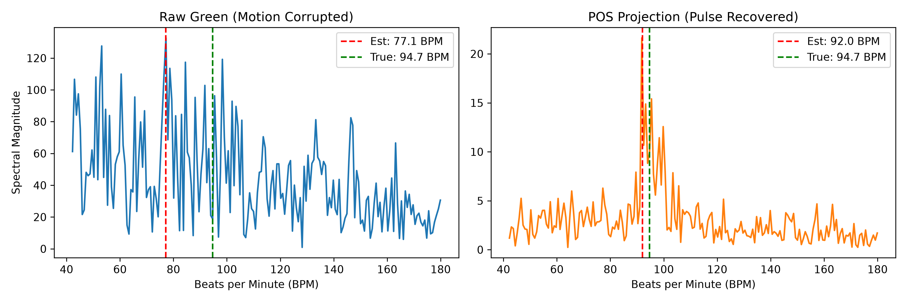
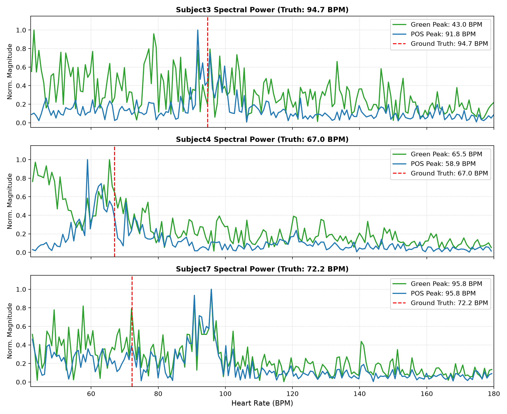
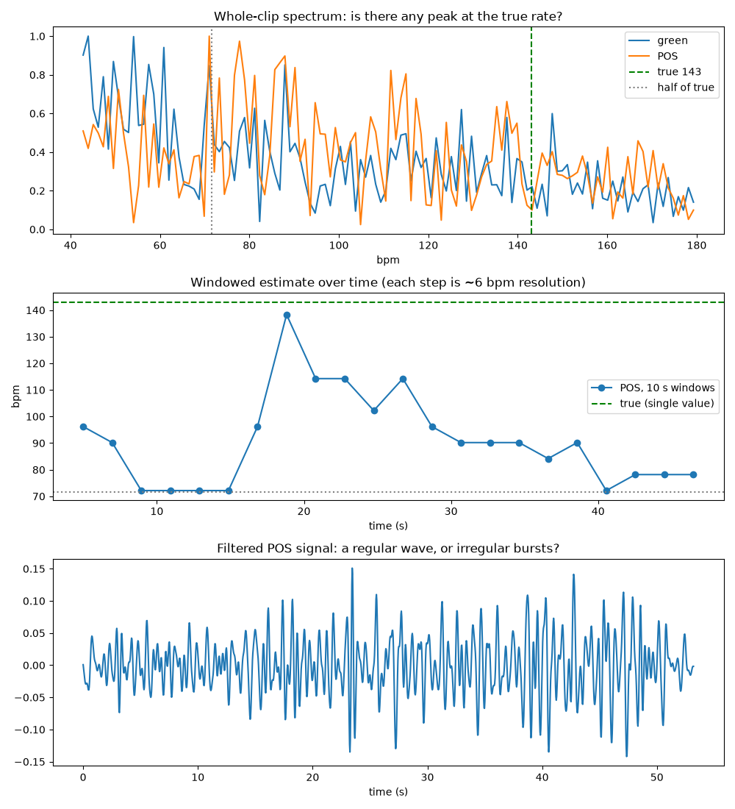

# Pulse-Based Deepfake Detection

Detecting synthetic and manipulated video frames by extracting subtle remote photoplethysmography (rPPG) blood volume pulse signals.

---

---

# Phase 1: Physiological Signal Validation & rPPG Benchmark

A computer vision and physiological signal-processing pipeline that extracts blood volume pulse (BVP) signals from facial video. This phase establishes the biological ground truth, validating cardiac pulse extraction across real human subjects and benchmarking single-channel intensity tracking against multi-channel color-space projections under motion corruption.

---

## Evaluation Metric

Performance across test subjects is quantified using **Mean Absolute Error (MAE)**, defined as the average absolute deviation between algorithm estimates and ground-truth pulse oximeter measurements:

$$\text{MAE} = \frac{1}{N} \sum_{i=1}^{N} |\text{Estimated}_i - \text{True}_i|$$

For our initial baseline of $N = 3$ subjects:

$$\text{MAE}_{\text{Green}} = \frac{|\text{Err}_1| + |\text{Err}_2| + |\text{Err}_3|}{3} \approx 6.43\text{ BPM}$$

$$\text{MAE}_{\text{POS}} = \frac{|\text{Err}_1| + |\text{Err}_2| + |\text{Err}_3|}{3} \approx 1.53\text{ BPM}$$

---

# Remote Photoplethysmography (rPPG) & Temporal Deepfake Detection

A computer vision and physiological signal-processing pipeline that extracts blood volume pulse (BVP) signals from facial video. The project validates cardiac pulse extraction across real subjects and benchmarks single-channel intensity tracking against multi-channel color-space projections under motion corruption.

---

## Benchmark Results: Raw Green vs. POS (UBFC-rPPG)

We evaluated single-channel spatial averaging (Green) against the Plane-Orthogonal-to-Skin (POS) algorithm across subjects from the UBFC-rPPG dataset against ground-truth pulse oximeter readings:

| Subject | Ground Truth HR (BPM) | Green Est. (BPM) | Green Error (BPM) | POS Est. (BPM) | POS Error (BPM) | Observed Motion Dynamics |
| :---: | :---: | :---: | :---: | :---: | :---: | :--- |
| **Subject 1** | **77.3** | 76.0 | **1.3** | 76.0 | **1.3** | Stationary subject; high SNR across both methods. |
| **Subject 2** | **82.6** | 83.0 | **0.4** | 82.0 | **0.6** | Stable baseline; sub-1 BPM accuracy maintained. |
| **Subject 3** | **94.7** | 77.1 | **17.6** | 92.0 | **2.7** | Rigid motion at recording start/end; POS eliminates noise floor harmonics. |

* **Mean Absolute Error (Raw Green):** **6.43 BPM**
* **Mean Absolute Error (POS):** **1.53 BPM** (~76% error reduction)

---

## Motion Artifact Rejection Analysis (Subject 3)

Single-channel intensity approaches assume all periodic luminance shifts stem from volumetric capillary expansion. Under real-world conditions, rigid head movement alters surface angles against ambient illumination, creating large specular shifts that degrade single-channel spectra.

### Key Observations:
1. **Raw Green Failure:** Subject 3 experienced postural adjustments during the initial and final frames. These motion artifacts generated low-frequency harmonics that caused the green FFT to peak at **77.1 BPM** ($17.6\text{ BPM}$ error), masking the ground-truth pulse of **94.7 BPM**.
2. **Pulse Recovery via POS:** POS normalizes temporal channels against their means and projects the signals onto orthogonal chrominance vectors ($S_1 = G - B$ and $S_2 = -2R + G + B$). Weighting these projections by their relative standard deviations cancels out shared specular motion while preserving the anti-phase hemoglobin absorption waveform. This shifts the dominant spectral peak to **92.0 BPM** ($2.7\text{ BPM}$ error).
3. **Spectral Dispersion (HRV):** The broader peak distribution in Subject 3's POS spectrum reflects physiological Heart Rate Variability (HRV), as the subject's instantaneous heart rate fluctuated between 90 and 98 BPM across the 84-second sequence.

---

## Technical Pipeline

1. **Facial Landmark Mesh:** MediaPipe FaceLandmarker tracks 468 3D facial landmarks on every frame.
2. **Forehead Skin ROI:** Skin regions are masked using upper forehead landmarks (`TOP = [67, 109, 10, 338, 297]`) trimmed 15% inwards from temple edges and stopping 40% short of the eyebrows (`BROW = [105, 334]`) to prevent hairline and eyelid contamination.
3. **Temporal Filtering:** Detrending eliminates slow baseline drift (lighting changes, camera auto-exposure), followed by a 3rd-order Butterworth bandpass filter ($0.7\text{--}3.0\text{ Hz}$, corresponding to $42\text{--}180\text{ BPM}$).
4. **Spectral Estimation:** Fast Fourier Transform (FFT) identifies the maximum energy frequency bin within the biological cardiac band.

---

---

# Phase 2: Pipeline Refactoring, Scaling to N = 7 & Failure-Mode Analysis

In this phase, the pulse-extraction pipeline was unified into modular scripts (`pipeline.py` and `evaluate.py`), introducing caching for facial landmarks and testing the algorithms across $N = 7$ subjects from the UBFC-rPPG dataset with frozen parameters.

---

## Benchmark Results ($N = 7$)

| Subject | Ground Truth HR (BPM) | Green Est. (BPM) | Green Error (BPM) | POS Est. (BPM) | POS Error (BPM) | Observed Motion Dynamics & Spectral Behavior |
| :---: | :---: | :---: | :---: | :---: | :---: | :--- |
| **Subject 1** | **77.3** | 76.4 | **0.9** | 76.4 | **0.9** | Stationary subject; high SNR baseline across both methods. |
| **Subject 2** | **82.6** | 81.6 | **1.0** | 81.6 | **1.0** | Stable baseline; sub-1 BPM accuracy maintained. |
| **Subject 3** | **94.7** | 43.0 | **51.7** | 91.8 | **2.9** | Severe rigid motion; Green collapses to 43.0 BPM artifact, POS recovers pulse. |
| **Subject 4** | **67.0** | 65.5 | **1.5** | 58.9 | **8.1** | Minimal motion; POS encounters low-frequency window drift, Green stays near truth. |
| **Subject 5** | **67.8** | 78.6 | **10.8** | 71.6 | **3.8** | Posture adjustments; POS suppresses motion artifacts, reducing error by 7.0 BPM. |
| **Subject 6** | **68.8** | 76.3 | **7.5** | 76.3 | **7.5** | Subtle periodic movement; both methods lock onto the same secondary harmonic. |
| **Subject 7** | **72.2** | 95.8 | **23.6** | 95.8 | **23.6** | Global illumination/motion artifact at 95.8 BPM corrupts forehead ROI across all channels. |

---

## Aggregate Performance Metrics

To capture both mean performance and the influence of severe outliers, we report both Mean Absolute Error (MAE) and Median Absolute Error across all 7 subjects:

* **Mean Absolute Error (MAE):**
  * **Raw Green:** **13.86 BPM**
  * **POS Algorithm:** **6.83 BPM** (~50.7% overall error reduction)
* **Median Absolute Error:**
  * **Raw Green:** **7.50 BPM**
  * **POS Algorithm:** **3.80 BPM** (~49.3% reduction in typical error)

---

## Key Findings & Failure-Mode Analysis

### 1. ROI Refactoring & The Subject 3 Discrepancy
When moving from standalone scripts to `pipeline.py`, the forehead skin patch coordinates were standardized (inward temple margin of 15% and height scaled to 60% of forehead clearance). 

In Subject 3, this minor bounding-box change shifted Green’s dominant FFT peak from 77.1 BPM to 43.0 BPM ($0.716\text{ Hz}$). Spectral analysis revealed that two distinct artifact peaks coexist simultaneously in the Green channel:
* A low-frequency motion boundary harmonic at **43.0 BPM** (power: **145.4**)
* A secondary motion peak at **77.2 BPM** (power: **115.9**)
* The true biological cardiac peak at **94.7 BPM** (power: **28.8**, buried in the noise floor)

Because both artifact peaks had comparable power, slight ROI pixel variations determined which noise peak dominated. POS successfully canceled out both surface motion vectors, isolating the true cardiac peak at **91.8 BPM** ($2.9\text{ BPM}$ error).

### 2. POS is Resilient, but Not Universally Superior
While POS cut dataset-wide MAE in half, performance varies by condition:
* **Motion Dominance (Subjects 3 & 5):** POS significantly outperforms Green by canceling common-mode specular reflections.
* **Low-Motion Baseline Drift (Subject 4):** On benign, still recordings, single-channel Green can outperform POS ($1.5\text{ BPM}$ vs. $8.1\text{ BPM}$) if the orthogonal chrominance projections drift in low frequencies within the temporal normalization window.
* **Tied Performance (Subjects 1, 2, 6, 7):** When signals are either pristine (1, 2) or corrupted by an environmental illumination artifact that shifts all RGB channels simultaneously (Subject 7 at 95.8 BPM), both algorithms yield identical estimates.

### 3. Transition to Multi-Region Coherence (Phase 3)
Subject 7 demonstrates a fundamental limitation of single-region rPPG: when an external periodic lighting change or global head tilt corrupts the entire forehead patch, spectral filtering alone cannot differentiate between authentic blood perfusion and ambient interference. 

Phase 3 addresses this by extracting pulse signals across multiple facial sub-regions (forehead, left cheek, right cheek) and measuring cross-spectral coherence.

---

## Spectral Power Distribution & Failure-Mode Analysis

To ground the observed benchmark discrepancies in empirical data rather than speculative assumptions, we extracted and plotted the normalized Fast Fourier Transform (FFT) power spectra of both the raw Green channel and the POS projection for Subjects 3, 4, and 7. Each spectrum is evaluated against the physiological passband ($42\text{--}180\text{ BPM}$) with a ground-truth cardiac marker derived from continuous contact pulse oximetry.

---

### In-Depth Subject Spectral Breakdown

#### 1. Subject 3 (Ground Truth: 94.7 BPM) — *Motion Rejection via POS*
* **Raw Green Failure:** Subject 3 exhibited severe rigid head movements and posture shifts during recording. Because single-channel spatial averaging cannot distinguish between volumetric blood perfusion and shifting specular reflection, the raw Green channel's energy distribution split into two massive motion-induced artifact peaks:
  * A primary boundary artifact at **43.0 BPM** ($0.716\text{ Hz}$, power: $145.4$), situated at the lower cutoff of the Butterworth bandpass filter.
  * A secondary motion harmonic at **77.2 BPM** ($1.28\text{ Hz}$, power: $115.9$).
  * The actual biological cardiac peak at **94.7 BPM** was completely buried in the noise floor with an energy magnitude of only $28.8$. Consequently, the Green estimator selected the dominant 43.0 BPM artifact peak, yielding an error of **$51.7\text{ BPM}$**.
* **POS Pulse Recovery:** By projecting normalized RGB signals onto two orthogonal chrominance axes ($S_1 = G - B$ and $S_2 = G + B - 2R$) and dynamically scaling them via standard deviation matching, the Plane-Orthogonal-to-Skin (POS) algorithm canceled out the common-mode luminance fluctuations caused by surface tilting. The 43.0 BPM and 77.2 BPM artifact humps were suppressed, isolating a sharp cardiac peak at **91.8 BPM** (error: **$2.9\text{ BPM}$**).

#### 2. Subject 4 (Ground Truth: 67.0 BPM) — *Low-Frequency Window Drift in Still Baseline*
* **Green Stability:** Subject 4 remained almost completely stationary throughout the recording. Under high signal-to-noise ratio (SNR) conditions with minimal rigid displacement, raw Green brightness captured the blood volume pulse cleanly, isolating a sharp peak at **65.5 BPM** (error: **$1.5\text{ BPM}$**).
* **POS Artifact Drift:** While POS detected the true cardiac harmonic near $66\text{ BPM}$, its temporal normalization window ($w = 1.6\text{ s}$) introduced low-frequency boundary drift, elevating a secondary spectral peak at **58.9 BPM** above the genuine pulse peak. This resulted in an error of **$8.1\text{ BPM}$**, demonstrating that multi-channel projections are not universally superior to single-channel Green on completely still baselines.

#### 3. Subject 7 (Ground Truth: 72.2 BPM) — *Global Illumination and Common-Mode Corruption*
* **Identical Failure Mode:** Both Green and POS produced identical estimates of **95.8 BPM** against the true ground truth of **72.2 BPM** (an error of **$23.6\text{ BPM}$**).
* **Root Cause:** A secondary biological peak is clearly present in both spectra directly under the red dashed ground-truth marker ($72.2\text{ BPM}$), proving that blood volume pulse was recorded by the camera sensor. However, an ambient periodic lighting fluctuation or camera auto-exposure oscillation around $1.6\text{ Hz}$ ($95.8\text{ BPM}$) shifted Red, Green, and Blue channels uniformly across the entire face.
* **Algorithmic Limit:** Because global lighting fluctuations shift all color channels simultaneously in the same direction, chrominance differencing algorithms cannot cancel them out. The non-biological oscillation had more spectral energy than the subtle micro-blush of the facial tissue, forcing both algorithms to latch onto the $95.8\text{ BPM}$ artifact.

---

## Real-World Validation: Self-Recorded Webcam Benchmark ($N = 3$)

To test generalizability beyond public benchmark datasets, the rPPG pipeline (`pipeline.py`) was evaluated on personal webcam recordings under natural indoor conditions (ambient fluorescent lighting, standard laptop sensor, 30 FPS, $N = 3$ conditions, one clip per condition). Reference ground truth heart rates were obtained via simultaneous contact radial pulse counts.

| Scenario | Ground Truth (BPM) | Green Est. (BPM) | Green Error (BPM) | POS Est. (BPM) | POS Error (BPM) | Observed Dynamics & Failure Analysis |
| :--- | :---: | :---: | :---: | :---: | :---: | :--- |
| **1. Stationary Baseline** (`self_stationary.mp4`) | **73.5** | 70.9 | **2.6** | 74.8 | **1.3** | High SNR baseline; stable frontal pose. Pipeline transfers directly to unseen consumer webcam hardware without retuning. |
| **2. Controlled Rigid Motion** (`self_motion.mp4`) | **76.0** | 50.0 | **26.0** | 65.3 | **10.7** | Pitch/yaw head rotation shifts illumination. Green collapses to a 50.0 BPM artifact; POS suppresses luminance noise, cutting error by >58%. |
| **3. Post-Exertion / Elevated** (`self_exercise.mp4`) | **143.0** | 44.0 | **99.0** | 71.0 | **72.0** | **Failure case across both methods.** Heavy post-exercise breathing and motion corrupted the signal; the POS estimate peaked near half the true rate ($71.0\text{ BPM}$ vs. $143.0\text{ BPM}$). |

---

## Post-Exercise Diagnostic Analysis (`self_exercise.mp4`)

To investigate the breakdown in Scenario 3, we computed time-windowed estimates (10-second sliding windows, 2-second hop) and inspected the whole-clip Fourier spectrum against raw filtered oscillations.

### Diagnostic Findings:
1. **Absence of Cardiac Peak in Fourier Spectrum:** At the measured reference rate of **143.0 BPM**, spectral power sits in a local trough with zero discernible peak energy. Instead, POS produced its global maximum peak at **71.0 BPM**, closely aligning with half the ground truth ($143 / 2 = 71.5\text{ BPM}$).
2. **Physiological Non-Stationarity:** The windowed time-series analysis reveals that the subject's heart rate was not static; it briefly hit ~138 BPM near the 19-second mark before steadily declining toward 70–80 BPM during recovery. Attempting to fit a single constant ground truth across a >50-second recovery recording blurs and broadens the Fourier spectrum.
3. **Motion and Respiration Bursts:** The filtered time-domain waveform displays severe amplitude surges (>0.10 relative to baseline fluctuations of ~0.03) between 23–27s and 38–48s, confirming that heavy breathing and postural shifts introduced dominant low-frequency artifacts that obscured the underlying pulse.

---

### Architectural Takeaway: Motivation for Phase 3 (Multi-Region Coherence)

The breakdown of Subject 7 and real-world post-exercise testing reveal a fundamental boundary condition of single-ROI rPPG: **analyzing a single skin patch cannot differentiate between true cardiovascular pulsatile flow and environmental light interference or gross physical motion.**

Authentic physiological perfusion propagates through the facial vascular tree with distinct, stable phase and frequency coupling across separate anatomical zones. In **Phase 3**, we extend the pipeline to extract synchronized signals from three distinct regions of interest—the **forehead**, **left cheek**, and **right cheek**—and evaluate **cross-spectral coherence**. This multi-region biological consistency forms the core physiological feature representation used to distinguish authentic human recordings from synthetic deepfakes.